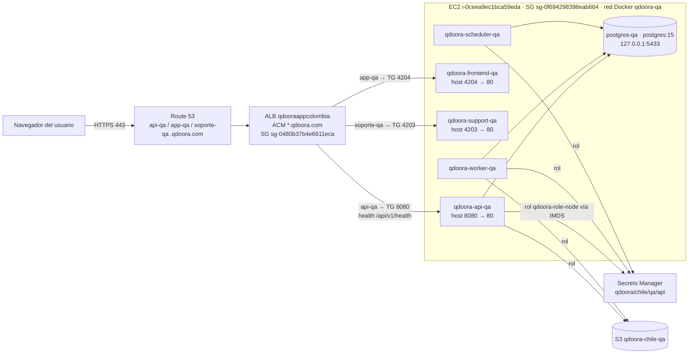

# Arquitectura de QA (EC2 compartido)

Estado al 2026-10-20. QA es el **único ambiente desplegado** de QdoorA Chile. Corre con Docker Compose en un EC2 que **comparte** con otras tres aplicaciones: Gregorio, Nutrición y QdoorA Colombia.

## Componentes y cómo se comunican

- **Los portales no llaman a la API por la red interna.** El JavaScript corre en el navegador y llama a `https://api-qa.qdoora.com/api`, que pasa por el ALB. Esa URL queda **compilada en la imagen** (`src/environments/environment.qa.ts`): si cambia el dominio, se reconstruyen los portales.
- **API, worker y scheduler usan la misma imagen** (ancla `x-api` del compose) con el mismo tag. Cola, caché y bloqueos viven en PostgreSQL (`QUEUE_CONNECTION=database`, `CACHE_STORE=database`, `SESSION_DRIVER=array`). **QA no tiene Redis**, por decisión de costo.
- **Credenciales de AWS:** los contenedores no tienen llaves. El SDK las obtiene del rol de la instancia por IMDSv2 (`HttpTokens=required`, hop limit 2; con hop limit 1 los contenedores no llegan). `AWS_ACCESS_KEY_ID` y `AWS_SECRET_ACCESS_KEY` van **vacías** en `.env.qa`.
- **Secretos:** `bootstrap/aws-secrets.php` los carga de `qdoora/chile/qa/api` al arrancar y los cachea. Después de cambiar el secreto: `up -d --force-recreate qdoora-api queue-worker scheduler`.
- **Laravel detrás del ALB:** `bootstrap/app.php` declara `trustProxies(at: '*')`. Es seguro solo porque el SG acepta 8080 únicamente desde el SG del ALB.

## Archivos en el EC2 (`/home/ubuntu/qdoora-chile`)

| Archivo | Qué es |
|---|---|
| `docker.compose.qa.yml` | Compose de QA. No está versionado; su referencia es `deploy/qa/docker.compose.qa.yml` (carpeta vedada, solo con supervisión) |
| `.env.qa` (600) y el enlace `.env → .env.qa` | Variables no secretas. El enlace es necesario para que el compose interpole `${DB_*}` |
| `deploy-qa.sh` (root, 755) | Script de despliegue; su copia versionada está en `qdoora-api/ops/qa/` |
| `backups/` (root, 700) | Dumps previos a cada migración (30 días) y `backups/compose/` (últimos 10) |

Volúmenes: `pgsql-qa` (datos de la base) y `storage-qa`. Contienen datos personales (Ley 21.719).

## Mapa de puertos del EC2

**Antes de publicar un puerto nuevo**, compáralo con esta tabla y con `sudo ss -tlnp` en el EC2. Si se reutiliza el puerto de otra aplicación, **se cae esa aplicación**.

| Puerto en el host | Dueño | Proceso | Quién puede entrar (SG) |
|---|---|---|---|
| 22 | Sistema | sshd (`PermitRootLogin no`, sin contraseña) | Solo `18.237.140.160/29` (EC2 Instance Connect) |
| 80 | Colombia (WordPress) | nginx | SG `sg-024935e259c5b54b9` |
| 3306, 33060 | Colombia (WordPress) | MySQL | Solo localhost |
| 4200 | Colombia (portal admin) | nginx | ⚠ `0.0.0.0/0` (pendiente de cerrar) |
| 4201 | Colombia (app) | nginx | SG del ALB |
| 4202 | Colombia (portal soporte) | nginx | ⚠ `0.0.0.0/0` (pendiente de cerrar) |
| **4203** | **Chile QA, portal soporte** | `qdoora-support-qa` | SG del ALB |
| **4204** | **Chile QA, portal cliente** | `qdoora-frontend-qa` | SG del ALB |
| 4208 | **Gregorio**, no usar | `gregorio-caddy-1` (→ 443 interno) | SG del ALB |
| 4209 | **Nutrición**, no usar | `nutricion-caddy-1` (→ 80 interno) | SG del ALB |
| 5432 | Colombia (PostgreSQL 14 del host) | postgres | Sin regla: cerrado desde fuera. `pg_hba` solo admite localhost |
| **5433** | **Chile QA, base** | `postgres-qa` | Solo `127.0.0.1` |
| 8000 | Colombia (API) | nginx | SG `sg-008d2c123f2ac8608` |
| **8080** | **Chile QA, API** | `qdoora-api-qa` | SG del ALB |

- Gregorio y Nutrición también tienen contenedores internos (API en 3000, web en 8080, PostgreSQL 16 en 5432) **sin publicar en el host**. El 8080 interno de ellos no choca con el 8080 del host de Chile; aun así, no copies sus nombres de servicio ni de red.
- Dominios en el mismo ALB: `nutricion.qdoora.com` y `gregorio.qdoora.com`. Las reglas del listener HTTPS son de todas las apps: **no cambies reglas ni prioridades ajenas**.
- Para conectarte a una base desde tu equipo **no se abre ningún puerto**: usa un túnel de SSM (`AWS-StartPortForwardingSession`) hacia `127.0.0.1:5433`.

## Agregar un servicio de Chile QA

1. Elige un puerto libre comparando la tabla con `ss -tlnp`. Para un portal, usa la serie 42xx que no esté en la tabla.
2. Publícalo en el compose y crea un target group con su health check.
3. Regla del SG de la instancia: ese puerto **solo desde `sg-0480b37b4e6611eca`**. Nunca `0.0.0.0/0`.
4. Agrega una regla host-header en el listener 443 del ALB y un registro alias A en Route 53.
5. Actualiza esta tabla y la del manual de operación.
