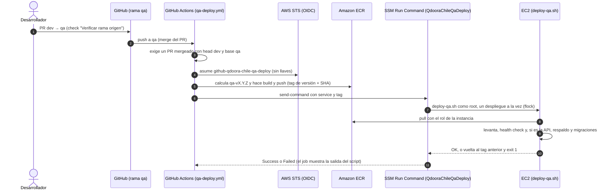

# Despliegue de QdoorA Chile en QA

Despliegue continuo desde la rama `qa` de cada repositorio. Las imágenes se construyen en GitHub Actions, se publican en ECR y se despliegan en el EC2 por SSM Run Command. **Nunca se compila en el servidor.**

## Flujo

## Repositorios, imágenes y servicios

| Repositorio GitHub (carpeta local) | ECR | `service` del despliegue | Contenedores que cambia |
|---|---|---|---|
| `gerenciaqdoora/backend_app_cl` (`qdoora-api`) | `qdoora-api` | `api` | API, worker y scheduler |
| `gerenciaqdoora/fronted_app_cl` (`fuse-starter`) | `qdoora-frontend` | `frontend` | Portal cliente |
| `gerenciaqdoora/support_admin_app` (`support-portal`) | `qdoora-support-admin-portal` | `support` | Portal soporte |

Registro: `310734905914.dkr.ecr.us-west-2.amazonaws.com`. Los portales se construyen con `target: runtime` y `BUILD_ENV=qa`.

## Piezas del pipeline

| Pieza | Dónde | Qué controla |
|---|---|---|
| `.github/workflows/qa-source-guard.yml` | Los 3 repos | Check "Verificar rama origen": un PR a `qa` solo se acepta desde `dev` del mismo repo |
| `.github/workflows/qa-deploy.yml` | Los 3 repos | Build, push y despliegue. `concurrency: qa-deploy`, permisos `id-token: write` y `contents: read` |
| Rol IAM `github-qdoora-chile-qa-deploy` | AWS | Confianza OIDC limitada a `refs/heads/qa` de los 3 repos. Push solo a los 3 repos ECR; `ssm:SendCommand` solo sobre la instancia y el documento propio. Plantillas en `qdoora-api/ops/qa/iam-github-*.json` |
| Documento SSM `QdooraChileQaDeploy` | AWS | Valida `service` (`api`, `frontend`, `support`) y `tag` (`^qa-v\d+\.\d+\.\d+$`). Timeout de 1800 s. Fuente: `qdoora-api/ops/qa/ssm-document-qdoora-qa-deploy.json` |
| `deploy-qa.sh` | `/home/ubuntu/qdoora-chile/` (copia en `qdoora-api/ops/qa/`) | El despliegue en sí |

**Plan GitHub Free:** los rulesets no se aplican a repos privados, así que un usuario con escritura puede hacer push directo a `qa`. El freno real es el paso del workflow que exige un PR mergeado `dev → qa`. Con GitHub Team, el ruleset `protect-qa` bloquea además los push directos (check exigido: "Verificar rama origen", fuente GitHub Actions).

## Qué hace `deploy-qa.sh <servicio> <tag>`

1. Valida el tag y el servicio, y toma el bloqueo `/var/lock/qdoora-qa-deploy.lock` (espera hasta 15 minutos).
2. Exige exactamente una imagen del repositorio en el compose, por el ancla `x-api`.
3. Respalda el compose en `backups/compose/` (conserva los 10 más recientes).
4. Hace login en ECR, cambia el tag y ejecuta `compose pull`. Si falla, vuelve atrás.
5. **Si es la API:**
   1. `pg_dump` a `backups/qdoora_qa_<fecha>_pre_<tag>.dump` (permisos 600; si falla, no migra). Borra los dumps con más de 30 días.
   2. Detiene el scheduler y espera a que terminen los jobs en ejecución.
   3. Levanta la API nueva y espera su health check.
   4. `php artisan migrate --force` y `optimize:clear`.
   5. Levanta el worker y el scheduler.
6. **Si es un portal:** lo levanta y espera su health check.
7. Si algo falla, vuelve al tag anterior y termina con error. **La vuelta atrás no revierte la base.**
8. Borra solo las imágenes de ese repositorio, conservando el tag actual y el anterior.

## Reglas

- **Migraciones:** automáticas solo en el despliegue de la API, siempre con respaldo previo. **Los seeders nunca corren solos**: se ejecutan a mano con `--class` y `--force`.
- **Volver a una versión:** se redespliega un tag existente con `aws ssm send-command --document-name QdooraChileQaDeploy --parameters 'service=api,tag=qa-vX.Y.Z'`, o con `sudo deploy-qa.sh` en el EC2. Si la versión nueva migró, hay que restaurar también la base desde su dump. **No se usa `migrate:rollback`** en Contabilidad, Nómina, Aduana ni Facturación: altera registros históricos.
- **Un solo scheduler:** nunca levantes otro QA contra los mismos servicios externos.
- **No usar** `docker system prune` ni `docker image prune -a`: el EC2 tiene otras aplicaciones, y con los contenedores detenidos se borraría `pgsql-qa`.
- **Si cambias `deploy-qa.sh`:** commit en `qdoora-api/ops/qa/` y luego copia al EC2 con `sudo install -o root -g root -m 755`.
- **Publicación manual** (si GitHub Actions no está disponible): `docker buildx build --platform linux/amd64 ... --push` con `AWS_PROFILE` de la cuenta `310734905914` y, después, un redespliegue del tag.

El paso a paso operativo (restaurar la base, seeders, cambios de `.env.qa`, problemas conocidos) está en el manual del workspace `docs/deploy/QA_EC2_ACTUALIZACIONES.md`.
