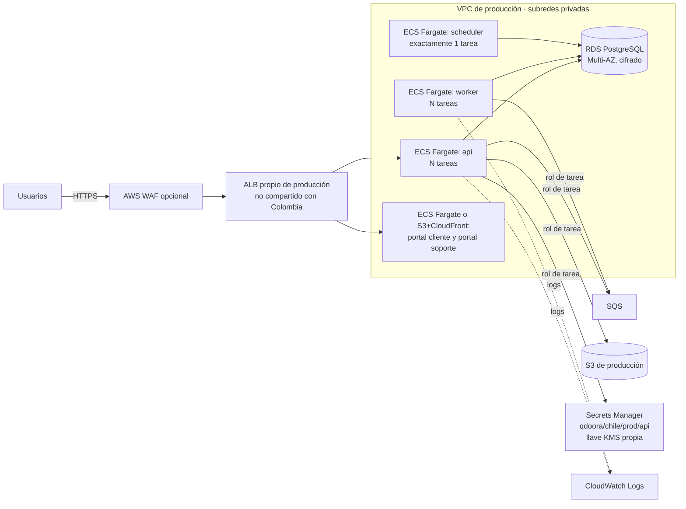

# Producción en AWS ECS (diseño objetivo, NO desplegado)

Al 2026-10-20 **no existe producción de QdoorA Chile**. Este archivo describe hacia dónde ir, no lo que hay. Ningún recurso de aquí existe. Antes de crear uno o de asumir un nombre, **pregunta**. Las decisiones que estén abiertas se presentan como opciones con su recomendación, sin resolverlas por tu cuenta.

## Arquitectura objetivo

## Qué cambia respecto de QA

| Tema | QA hoy | Producción objetivo |
|---|---|---|
| Cómputo | Docker Compose en un EC2 compartido | ECS Fargate, un servicio por proceso (api, worker, scheduler) con la misma imagen |
| Base | `postgres:15` en contenedor | RDS PostgreSQL Multi-AZ, con snapshots automáticos y restauración probada |
| Cola | `database` | `sqs` (obligatorio) |
| Caché y sesión | `database` / `array` | `database` por decisión vigente (sin Redis por costo); reevaluar con carga real |
| Credenciales | Un rol compartido por todo el EC2 | **Un rol por tarea**: cada servicio ve solo lo suyo |
| Archivos | S3 `qdoora-chile-qa` | Bucket propio de producción, privado y cifrado |
| Secretos | `qdoora/chile/qa/api` con `aws/secretsmanager` | `qdoora/chile/prod/api` con llave KMS propia; solo el rol de la tarea puede descifrar |
| Migraciones | `deploy-qa.sh` dentro del contenedor de la API | Tarea única de ECS (`RunTask`) con la imagen nueva, **después de un snapshot de RDS** y antes de actualizar el servicio |
| Disparo | Push a `qa` (automático) | Push o tag en `main` con **aprobación manual** (GitHub Environment `production`, que en repos privados exige un plan de pago) |
| Logs | `docker logs` | stdout/stderr → CloudWatch Logs, con retención definida |
| Red | ALB compartido con Colombia | ALB y SG propios; tareas en subredes privadas, sin IP pública |

## Decisiones abiertas (preguntar)

1. **¿Cuenta de AWS separada para producción?** Recomendado: sí, con AWS Organizations, para que un incidente en QA o en las otras apps no alcance producción. Como mínimo, una VPC, roles y secretos propios.
2. **Portales:** contenedor Nginx en ECS o S3 + CloudFront. Hoy la URL de la API va compilada en la imagen (`environment.<ambiente>.ts`), así que se necesita un build por ambiente o configuración en tiempo de ejecución.
3. **IaC** (Terraform o CDK) o creación a mano. Recomendado: IaC antes del primer despliegue.
4. **Plan de GitHub:** sin Team no hay rulesets ni Environments con revisores en repos privados.

## `APP_KEY` de producción

Se genera una vez y no se rota por calendario, porque cifra datos persistentes: contraseñas de certificados SII y credenciales de sistemas externos. El detalle (llave KMS propia, rotación solo ante un incidente con `APP_PREVIOUS_KEYS` y nuevo cifrado, y cifrado de sobre con KMS como mejora) está en `qdoora-references/agent/rules/PENDIENTE.md` §21.

## Qué NO se lleva de QA a producción

- Volúmenes montados desde carpetas del host y la base en contenedor.
- `trustProxies(at: '*')` sin un SG que solo acepte tráfico del ALB.
- Un rol compartido entre servicios, o llaves de AWS en archivos.
- Despliegue directo sin aprobación ni snapshot previo.
