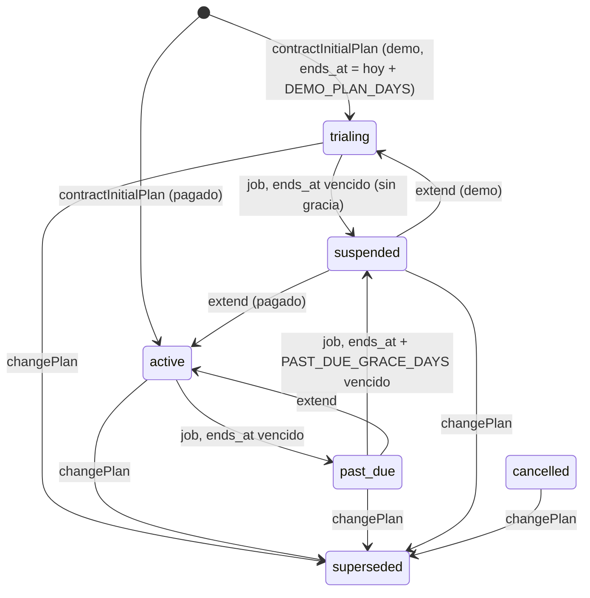

# Ciclo de vida, servicios y superficie

## ¿Quién es dueño de qué?

| Regla o acción | Dueño (`qdoora-api`) |
|---|---|
| Alta de cliente (demo o pagado, sin Aduana) | `SubscriberService::provisionClientDemo` → `SubscriberPlanService::contractInitialPlan`. `CreateClientRequest` rechaza planes con ADUANA |
| Alta de agencia de Aduana | `SubscriberService::provisionCustomsSubscriber` (plan con ADUANA incluido, empresa con agente del catálogo Anexo 51, importación del plan de cuentas) |
| Contratar el primer plan | `SubscriberPlanService::contractInitialPlan` (lock del suscriptor, 409 si ya hay un plan vigente) |
| Cambiar de plan o de tramo | `SubscriberPlanService::changePlan` |
| Resolver el tramo | `SubscriberPlanService::resolveTierId` (el pedido si el plan lo ofrece y está activo; si no, el por defecto; sin fallback) |
| Límites, capacidad y tope de Aduana | `SubscriptionLimitService` (`effectiveLimit`, `limitForPlan`, `capacity`, `currentUsage`, `isAduanaCapped`) |
| Cupos extra | `SupportAddonService::grant` / `revoke` |
| Extensión de plazo | `SubscriptionExtensionService::extend` |
| Vencimiento diario | `SubscriptionExpirationService::run` (comando `subscription:expire`) |
| Página de Vencimientos | `SubscriptionExpirationQueryService::list` |
| Corrección de tramos | Comando `subscription:repair-tiers` (usa `changePlan`) |
| Catálogo | `PlanManagerService` |
| Baja y reactivación | `SubscriberService::deleteSubscriber` / `reactivateSubscriber` |
| Usuario de equipo | `SubscriberService::crearUsuarioTrabajo` (respeta el límite de usuarios) |
| Empresa nueva | `CompanyService::crearEmpresa` (respeta el límite de empresas; mensaje propio cuando el tope es el de Aduana) |
| Menú según el plan | `UserService::getNavigation` (`AppModules::STRUCTURE` + módulos contratados) |
| Permisos del dueño al cambiar de plan | `UserPermissionService::normalizaPermisosUsuario` (**destructivo**: solo al dueño) |

## Máquina de estados de `subscriber_plan`

- `changePlan` reemplaza el plan actual en cualquier estado salvo `superseded`. Orden obligatorio: valida límites → marca el actual `superseded` (+ `superseded_at`) → crea el nuevo → traslada los cupos vigentes y revoca los del anterior (`system:plan-change`) → desactiva los módulos del anterior → enlaza `superseded_by` → actualiza `subscriber.is_demo`/`valid_to` → normaliza permisos del dueño → registra log.
- `assertFitsLimit` solo rechaza un cambio que **baja** el límite por debajo del uso; un exceso previo que el cambio no empeora pasa.
- `extend` exige `ends_at` existente y una fecha nueva mayor que hoy y que el `ends_at` actual; 409 sin plan o con plan `cancelled`.
- `reactivateSubscriber` restaura el suscriptor y su `valid_to`, **pero no reactiva el plan**: un plan suspendido se recupera con extender o cambiar plan.
- Configuración: `config/subscription.php` (`DEMO_PLAN_DAYS` = 15, `PAST_DUE_GRACE_DAYS` = 7).

## Job, comandos y middleware

| Pieza | Comportamiento |
|---|---|
| `subscription:expire [--dry-run]` | Programado a las 00:15 (`routes/console.php`, `withoutOverlapping`, alerta en log si falla). En QA corre en el contenedor `scheduler` |
| `subscription:repair-tiers [--dry-run]` | Planes vigentes con tramo no ofrecido, sin tramo de empresas o en un tramo inactivo → `changePlan` al mismo plan con sus tramos por defecto. Avisa y sigue si uno falla |
| `subscription.active` (`EnsureSubscriptionActive`) | 402 `SUBSCRIPTION_INACTIVE` si el plan actual está `suspended` o `cancelled`. Pasan: sin plan, `past_due`, Soporte/Admin, y `navigation`, `user-details`, `profile` |
| `EnsureModuleActive`, `EnsureWithinLimits` | Existen en `app/Http/Middleware` pero **no están registrados**. La verificación de módulo va por `AuthorizesClientRequests::authorizeModuleContracted()` en los FormRequests |

## Login y menú del Portal Cliente

`POST v1/login` y `GET v1/user-details` devuelven en `user`:

| Campo | Origen | Uso en `fuse-starter` |
|---|---|---|
| `plan_type` | `activePlan.plan.tier` (`demo`/`basic`/`pro`) | Informativo. **No sirve para decidir módulos** |
| `active_modules` | `Subscriber::modules()` en minúscula (`contabilidad`, `billing`, `nomina`, `aduana`) | `hasModuleGuard`, `hasActiveModule(user, code)` de `core/user/user.utils.ts` |
| `subscription` | `currentPlan`: `status`, `ends_at`, `suspends_at`, `aduana_capped` (null sin plan) | Banner de vencimiento (`subscription-banner`), `isAgencySubscriber(user)` |

`GET v1/navigation` (`UserService::getNavigation`): con ADUANA activo, el ítem `general.empresa` se llama **"Empresa"** y abre `/general/company/update/{id}` (empresa seleccionada si es del suscriptor; si no, la primera); sin ADUANA, "Empresas" con la lista. El interceptor del portal reacciona al 402.

Flujo de agencia en el Portal Cliente (`aduana_capped`): el guard de `company.route.ts` bloquea "crear" y lleva a editar la empresa, el selector muestra la empresa fija, y `CreaEmpresaRequest`/`ActualizarEmpresaRequest` exigen `agent_name`/`agent_code` (en el portal son de solo lectura: los carga el alta desde Soporte).

## Endpoints de Soporte (`v1/support`)

| Rol | Método y ruta | Acción |
|---|---|---|
| Staff (`support.staff`) | `GET subscribers`, `GET subscribers/{id}` | Directorio y detalle (llaves `latest_suscriptor_plan.base_plan.name`, `metrics.plan_*`) |
| Staff | `GET subscribers/{id}/capacity` | Capacidad: tramo, cupos, límite, uso, exceso, `aduana_capped` |
| Staff | `GET subscriptions/expirations?group=upcoming\|past_due\|suspended` | Vencimientos paginados |
| Admin (`admin.only`) | `POST clients` | Alta de cliente sin Aduana |
| Admin | `POST create/aduana-subscriber`, `GET aduana-agents` | Alta de agencia y catálogo de agentes |
| Admin | `POST subscribers/{id}/plan` | Cambiar plan (`plan_slug`, tramos opcionales, `reason`) |
| Admin | `POST subscribers/{id}/plan/extend` | Extender plazo (`ends_at` > hoy, `reason`) |
| Admin | `POST subscribers/{id}/addons`, `POST subscribers/{id}/addons/{addonId}/revoke` | Cupos extra (`dimension`, `quantity`, `reason`) |
| Admin | `DELETE subscribers/{id}`, `POST subscribers/{id}/reactivate` | Baja y reactivación |
| Admin | `plans`: `GET /`, `GET /customs`, `GET /quantity-tiers`, `POST /`, `PUT /{id}`, `PATCH /{id}/deprecate`, `POST /discount-codes` | Gestor de Planes |

Los FormRequests de estas rutas viven en `app/Http/Requests/Support/Subscription/` y `Support/Plan/`, con `AuthorizesSupportRequests` (`authorizeAdmin()` por defecto; `authorizeSupportStaff()` solo en lectura) y anti-IDOR en `withValidator`.

## Frontends

| Portal | Piezas |
|---|---|
| `fuse-starter` (Angular 18) | `core/user/user.types.ts` (`User`, `UserSubscription`), `core/user/user.utils.ts`, `layout/common/subscription-banner`, interceptor 402 en `core/auth/auth.interceptor.ts`, guard de empresa en `modules/admin/general/company/company.route.ts` |
| `support-portal` (Angular 21) | `core/services/subscriber.service.ts` (`getCapacity`, `grantAddon`, `revokeAddon`, `extendPlan`, `getExpirations`, `changePlan`), `modules/subscribers/subscriber-detail/` (diálogos de cambiar plan, extender y dar cupos con antes/después), `modules/subscribers/subscription-expirations/`, Gestor de Planes |

## Pendientes conocidos (2026-10-20)

- `changePlan` hacia un plan con ADUANA no asigna agente ni reduce empresas: el exceso se regulariza a mano ("bloquear solo lo nuevo").
- Ninguna pasarela escribe `subscriber_plan_payment`.
- El límite de usuarios cuenta solo al equipo: el dueño no consume cupo.
