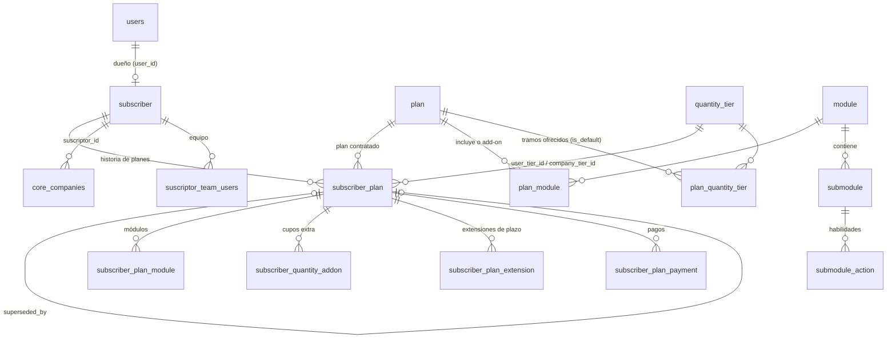

# Modelo de datos de suscripciones

Esquema de PostgreSQL de `qdoora-api` verificado el 2026-10-20. Ante la duda, la fuente es la base: `\d <tabla>` o `information_schema.columns`.

## Tres capas

| Capa | Tablas | Qué guarda |
|---|---|---|
| Catálogo | `plan`, `module`, `submodule`, `submodule_action`, `quantity_tier`, `plan_module`, `plan_quantity_tier`, `discount_code` | Qué se puede contratar. Lo administra Soporte (Gestor de Planes) o una migración |
| Contratación | `subscriber`, `subscriber_plan`, `subscriber_plan_module`, `subscriber_quantity_addon`, `subscriber_plan_extension`, `subscriber_plan_payment` | Qué tiene contratado cada suscriptor, con su historia |
| Acceso | `users`, `suscriptor_team_users`, `roles`, `core_companies` y las tablas de permisos | Quién es el dueño, su equipo y sus empresas (`core_companies.suscriptor_id`) |



## Columnas (`!` = NOT NULL)

| Tabla | Columnas |
|---|---|
| `subscriber` | id!, user_id!, is_demo!, subscribed_at, valid_to, unsubscribed_at, created_at, updated_at, deleted_at (soft delete) |
| `subscriber_plan` | id!, subscriber_id!, plan_id!, plan_name_snapshot!, user_tier_id!, company_tier_id, status!, starts_at, ends_at, superseded_at, superseded_by, internal_notes, timestamps |
| `subscriber_plan_module` | id!, subscriber_plan_id!, module_code!, origin! (`plan`/`addon`), activated_at, deactivated_at, timestamps. Único `(subscriber_plan_id, module_code)` |
| `subscriber_quantity_addon` | id!, subscriber_plan_id!, dimension! (`users`/`companies`), quantity!, unit_price!, total_price!, reason, granted_by!, valid_from!, valid_until, revoked_at, revoked_by, revoked_reason, timestamps |
| `subscriber_plan_extension` | id!, subscriber_plan_id!, previous_ends_at, new_ends_at!, previous_status!, new_status!, reason!, extended_by, timestamps |
| `subscriber_plan_payment` | id!, subscriber_plan_id!, gateway!, gateway_ref, gateway_signature, status! (`pending`/`paid`/`failed`/`refunded`), subtotal!, discount_amount!, total!, months_paid!, paid_at, timestamps |
| `plan` | id!, slug! (único), name!, tier! (`demo`/`basic`/`pro`), target! (`contador`/`empresa`/`all`), currency!, base_price!, base_user_quantity!, base_company_quantity, is_public!, active!, deprecated_at, notes, timestamps |
| `plan_module` | id!, plan_id!, module_code!, included!, addon_price!, timestamps |
| `plan_quantity_tier` | id!, plan_id!, quantity_tier_id!, is_default!, timestamps |
| `quantity_tier` | id!, dimension!, tier_level!, code! (único), name!, min_qty!, max_qty!, unit_price!, active!, timestamps |
| `module` | code! (PK), name!, standalone_price!, is_addon!, active!, description, icon, subtitle, order!, timestamps |
| `submodule` | code! (PK), name!, module!, puc_assignation!, active!, icon, link, children (json), order!, timestamps |
| `submodule_action` | id!, submodule!, code!, name!, requires_operation!, subscriber_only!, timestamps |

`base_user_quantity` y `base_company_quantity` de `plan` son heredadas: **los límites salen del tramo** (`quantity_tier.max_qty`), no de ahí.

## Índices del dominio

| Índice | Para qué |
|---|---|
| `idx_subscriber_user` (`subscriber.user_id`) | Resolver el suscriptor del dueño en cada request |
| `idx_subscriber_plan_lookup` (`subscriber_id, status`) | Plan actual y vigente |
| `idx_subscriber_plan_expiry` (`status, ends_at`) | Job de vencimiento y página de Vencimientos |
| **`uq_subscriber_plan_open`** (único parcial `subscriber_id WHERE status IN ('trialing','active','past_due','suspended')`) | A lo más un plan vigente por suscriptor |
| `idx_addon_lookup` (`subscriber_plan_id, dimension, revoked_at`) | Suma de cupos vigentes |
| `idx_plan_payment_plan`, `idx_roles_suscriptor`, `idx_stu_user`, `idx_stu_suscriptor`, `idx_companies_suscriptor` | Llaves foráneas consultadas en cada request |

## Invariantes

1. **Un plan vigente por suscriptor.** Lo garantiza el índice parcial. Quien cree un plan debe cerrar antes el vigente (`changePlan` marca `superseded` y después crea el nuevo).
2. **La historia es una cadena.** Cada plan reemplazado queda `status = superseded`, con `superseded_at` y `superseded_by` apuntando al siguiente. Sus módulos quedan con `deactivated_at` y sus cupos con `revoked_by = 'system:plan-change'`.
3. **`plan_name_snapshot`** guarda el nombre del plan al contratar: un cambio de nombre en el catálogo no reescribe la historia.
4. **Los tramos se referencian por id.** Renombrar un tramo (código o nombre) mantiene las referencias; borrarlo solo es posible si ninguna suscripción lo usó (`subscriber_plan.user_tier_id`/`company_tier_id` sin `ON DELETE`).
5. **Los cupos extra son permanentes y aditivos.** `valid_until` nulo; se suman al `max_qty` del tramo mientras no estén revocados.
6. **Sin borrado físico.** `subscriber` usa soft delete; las filas de contratación solo se cierran (`superseded`, `deactivated_at`, `revoked_at`).
7. **Aduana.** La empresa de una agencia se enlaza al agente con `core_companies.aduana_anexo51_agent_id` (único) y copia `agent_name`/`agent_code` del catálogo `aduana_anexo51_agent`.

## Consultas de diagnóstico (solo lectura)

```sql
-- Historia de planes de un suscriptor
select sp.id, p.slug, sp.status, ut.code user_tier, ct.code company_tier, sp.starts_at, sp.ends_at, sp.superseded_by
from subscriber_plan sp join plan p on p.id = sp.plan_id
left join quantity_tier ut on ut.id = sp.user_tier_id left join quantity_tier ct on ct.id = sp.company_tier_id
where sp.subscriber_id = :id order by sp.id;

-- Suscriptores con más de un plan vigente (debe dar 0 filas)
select subscriber_id, count(*) from subscriber_plan
where status in ('trialing','active','past_due','suspended') group by 1 having count(*) > 1;
```
